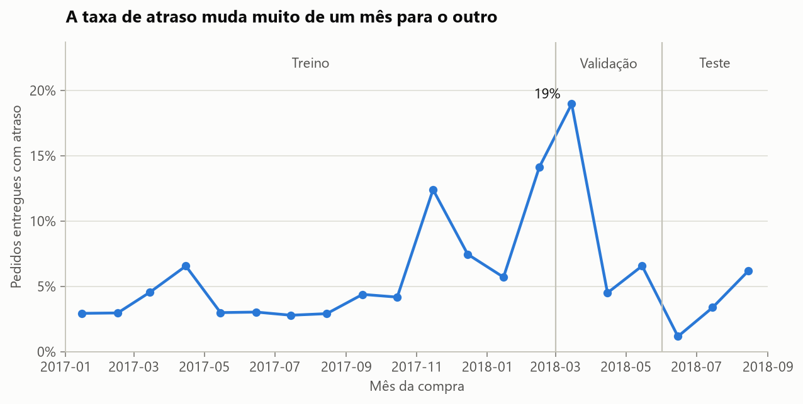
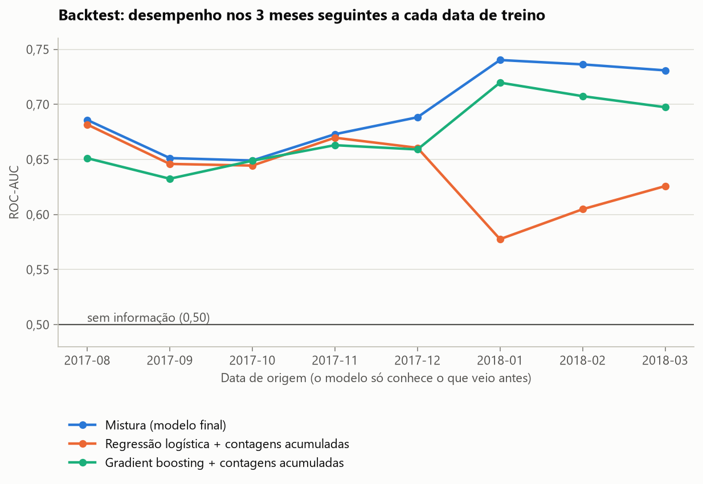
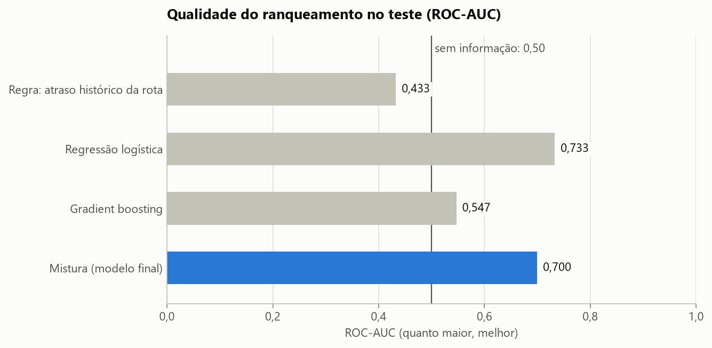
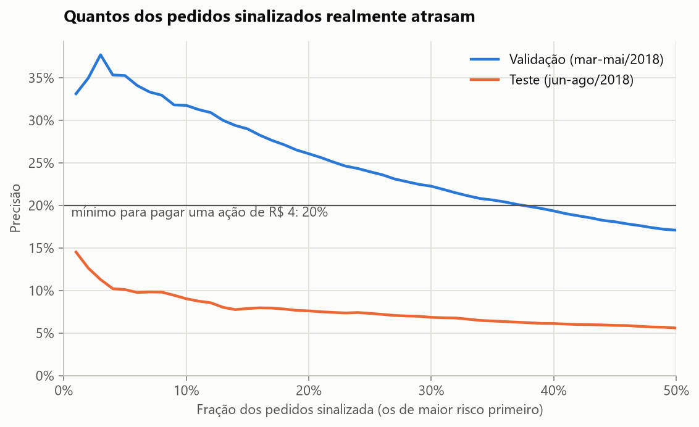

# Previsão de atraso em entregas de e-commerce

Modelo que estima, **no momento da compra**, o risco de um pedido chegar depois do prazo prometido ao cliente. Usa os dados públicos da Olist (96 mil pedidos entregues no Brasil entre 2017 e 2018).

O ponto central do projeto não é a nota do modelo. É mostrar como um resultado que parecia ótimo na validação desabou em dados novos, como o problema foi diagnosticado e o que mudou por causa disso.

## Resultado em resumo

Avaliação em 18.603 pedidos de junho a agosto de 2018, comprados depois da data de corte do treino:

| Medida | Valor |
|---|---|
| ROC-AUC do modelo final | 0,70 |
| Faixa prevista pelo backtest (8 datas de treino) | 0,65 a 0,74 |
| Taxa de atraso no período | 3,6% |
| Atrasos entre os 10% de pedidos de maior risco | 6,8% (1,9 vez a média) |
| Atrasos capturados sinalizando 10% dos pedidos | 19% |
| Custo máximo de uma ação preventiva para ela se pagar | R$ 1,36 por pedido |

Em uma frase: o modelo ordena os pedidos por risco de forma útil e estável, mas não bem o bastante para pagar uma ação cara. Serve para ações baratas, como um aviso proativo ao cliente, e não para trocar a modalidade de frete.

## O problema

Um pedido atrasado custa caro: reclamação, atendimento, reembolso de frete e um cliente que tende a não voltar. Se a empresa souber no momento da compra quais pedidos têm mais risco, pode agir antes: avisar o cliente, priorizar a expedição ou cobrar o vendedor.

- **Alvo:** o pedido foi entregue depois do dia prometido (6,8% dos pedidos).
- **Momento da decisão:** o instante da compra. Nada que acontece depois pode entrar no modelo.
- **Uso:** toda semana, sinalizar os 10% de pedidos de maior risco para uma ação preventiva.

## Dados e variáveis

Sete tabelas da Olist (pedidos, itens, pagamentos, clientes, vendedores, produtos e geolocalização) viram uma tabela com uma linha por pedido e 26 variáveis:

| Grupo | Exemplos |
|---|---|
| Pedido | prazo prometido, valor, frete, peso, categoria, forma de pagamento |
| Geografia | estados do vendedor e do cliente, distância em linha reta entre os CEPs |
| Histórico do vendedor | taxa de atraso, dias que leva para postar, pedidos nos últimos 30 dias |
| Histórico da rota e do destino | taxa de atraso e tempo típico de entrega; folga do prazo prometido sobre esse tempo |

Dois cuidados com os dados brutos que mudam o resultado:

- Os CEPs de clientes e vendedores vêm sem o zero à esquerda, e os da tabela de geolocalização vêm com ele. Sem padronizar, mais de um em cada quatro pedidos fica sem distância.
- A data prometida vem como meia-noite do último dia do prazo. Comparar por horário marcaria como atraso quem recebeu no próprio dia prometido (8,1% de atraso em vez de 6,8%).

## Como evitei vazamento de dados

Vazamento é o modelo usar, sem querer, informação que não existiria na hora da decisão. Quatro regras do projeto:

1. **Histórico com data de conhecimento.** A taxa de atraso de um vendedor só conta pedidos cujo resultado já era conhecido antes da compra atual, ou seja, já entregues. Um pedido comprado ontem e ainda em trânsito não entra.
2. **Teste automático.** Um teste empurra 60 dias para a frente tudo o que aconteceu depois de uma data e confere que as variáveis dos pedidos anteriores não mudam. Para garantir que o teste funciona, injetei um vazamento de propósito e ele falhou, como devia.
3. **Variáveis descartadas por cautela.** A data-limite de postagem pode depender da aprovação do pagamento, que acontece depois da compra. Ficou de fora, junto com tudo o que é posterior: datas de postagem e entrega, status e avaliação do cliente.
4. **Rótulo só quando maduro.** Na data do treino, só entra o pedido cujo prazo prometido já venceu. Filtrar pelos já entregues deixaria os pedidos recentes artificialmente pontuais, porque os atrasados ainda não chegaram. Foram descartados 4.270 pedidos por esse motivo.

## Validação no tempo



| Período | Compras | Pedidos | Taxa de atraso |
|---|---|---|---|
| Treino | fev/2017 a fev/2018 | 56.299 | 6,7% |
| Validação | mar/2018 a mai/2018 | 16.281 | 10,8% |
| Teste | jun/2018 a ago/2018 | 18.603 | 3,6% |

A taxa de atraso vai de 1% a 19% conforme o mês. Essa instabilidade é a principal dificuldade do problema, e separar os dados por sorteio a esconderia.

## O que deu errado, e o que mudou

**1ª versão.** Gradient boosting com variáveis que acompanhavam o momento da operação (taxa de atraso geral dos últimos 30 dias, histórico da rota em 90 dias). Na validação, o resultado era ótimo: PR-AUC de 0,29 contra 0,11 de um modelo sem informação. No teste, 0,05 contra 0,04. O modelo tinha aprendido a crise de fevereiro e março de 2018, e a crise acabou.

**Mudança de método.** Uma única validação mede o modelo em um único regime. Passei a comparar candidatos em um backtest: o treino é repetido em 8 datas, e cada modelo é avaliado nos 3 meses seguintes a cada uma, usando só o período de desenvolvimento. Esse backtest teria reprovado a 1ª versão antes de qualquer olhar ao teste.

**2ª versão.** Histórico longo no lugar das janelas curtas. Melhorou no backtest, mas no teste a regressão logística simples ganhou do boosting com folga. Investigando só com dados de desenvolvimento, a causa apareceu: as contagens acumuladas (número de entregas do vendedor, da rota, do destino) crescem com o calendário e funcionam como um relógio escondido. O modelo usava "a rota tem entre X e Y entregas" para decorar um período. A linha laranja abaixo mostra o efeito na regressão logística a partir de janeiro de 2018.



**Versão final.** As contagens saíram. Para não perder a informação de "pouco histórico", as taxas passaram a ser suavizadas: um vendedor com poucas entregas é puxado para a média geral, e um vendedor com 1 atraso em 1 entrega deixa de aparecer como "100% de atraso". O modelo final é a média das probabilidades de uma regressão logística e de um gradient boosting.

Resultado do backtest (ROC-AUC nas 8 datas):

| Candidato | Média | Pior caso |
|---|---|---|
| **Mistura (modelo final)** | **0,694** | **0,649** |
| Regressão logística | 0,687 | 0,635 |
| Gradient boosting | 0,684 | 0,645 |
| Gradient boosting + contagens acumuladas | 0,672 | 0,632 |
| Regressão logística + contagens acumuladas | 0,639 | 0,578 |
| Gradient boosting, 1ª versão das variáveis | 0,634 | 0,575 |
| Regra sem ML: atraso histórico da rota | 0,624 | 0,578 |

Os dois modelos se alternam na frente (a logística vence em 5 das 8 datas, por margens pequenas). A mistura foi igual ou melhor que os dois em 6 das 8 e teve a melhor média e o melhor pior caso, que eram o critério de escolha.

## Resultado no teste



| Modelo | ROC-AUC | PR-AUC |
|---|---|---|
| Sem informação | 0,50 | 0,036 |
| Regra sem ML: atraso histórico da rota | 0,43 | 0,034 |
| Regressão logística | 0,73 | 0,099 |
| Gradient boosting | 0,55 | 0,052 |
| **Mistura (modelo final)** | **0,70** | **0,080** |

Leituras que importam:

- **O teste ficou dentro da faixa do backtest** (0,65 a 0,74). O backtest serviu para prever o desempenho, que é a função dele.
- **A regra sem ML ficou abaixo do acaso** (0,43). As rotas que mais atrasavam no passado deixaram de ser as que mais atrasam. Histórico bruto, sozinho, engana.
- **A regressão logística sozinha ganhou da mistura no teste.** Não troquei o modelo por isso: escolher o modelo pelo teste é o erro que este projeto existe para evitar. O boosting foi mal no teste (0,55), e a mistura protegeu o resultado dessa queda.
- **O desempenho cai com a distância do treino:** ROC-AUC de 0,77 em junho, 0,66 em julho e 0,62 em agosto. Em produção, o retreino teria de ser mensal.

### Vale a pena usar?

Premissas declaradas antes de ver os resultados, e que não são números da Olist: um atraso custa R$ 40, a ação preventiva custa R$ 4 por pedido e evita metade dos atrasos em que é aplicada. Com elas, a ação só se paga quando pelo menos 20% dos pedidos sinalizados atrasariam.



| Política | Pedidos sinalizados | Precisão | Atrasos capturados | Resultado |
|---|---|---|---|---|
| Corte de probabilidade escolhido na validação | 16,5% | 8,0% | 36% | prejuízo de R$ 7.380 |
| 10% de maior risco de cada semana | 10% | 6,8% | 19% | prejuízo de R$ 4.928 |

Na validação, o corte por probabilidade dava economia de R$ 4.424. No teste, a mesma regra dá prejuízo: a taxa de atraso caiu de 10,8% para 3,6%, e a probabilidade do modelo continuou no patamar antigo (prevê cerca de 3 vezes o atraso observado). Por isso a política recomendada usa só a ordem dos pedidos dentro da semana, que não depende do patamar.

A conclusão honesta: com uma ação de R$ 4, o modelo não se paga em um período calmo como o do teste. Cada pedido sinalizado evita em média R$ 1,36 de custo de atraso, então **a ação precisa custar menos que isso**. Um aviso proativo por mensagem cabe nessa conta; um frete expresso, não. Em meses de crise, como os da validação, a precisão no topo passa de 30% e até a ação de R$ 4 se paga.

## Limitações

- **O teste foi consultado três vezes** durante o desenvolvimento (uma por versão). As decisões de cada rodada foram tomadas com evidência do período de desenvolvimento, mas o número do teste deixou de ser uma estimativa intocada. A faixa do backtest é a expectativa mais confiável.
- **A probabilidade não é calibrada entre regimes.** O modelo serve para ordenar pedidos, e não para afirmar "este pedido tem 30% de chance de atrasar".
- **Algumas variáveis atrapalharam no teste** (tempo típico de entrega do destino, valor do frete), sinal de que o boosting ainda acompanha parte da mudança de regime.
- **Faltam as causas diretas do atraso:** transportadora, clima, greves. Nada disso está nos dados.
- **Pedidos com mais de um vendedor** (1,3%) são representados pelo item de maior valor.
- **Menos de dois anos de dados** de um único marketplace. Não dá para separar sazonalidade de tendência.

## Próximos passos

1. Medir a importância das variáveis dentro do backtest, para remover as instáveis sem usar o teste.
2. Avaliar retreino mensal no backtest, em vez de um modelo usado por três meses.
3. Recalibrar a probabilidade com os resultados mais recentes, para permitir decisões por custo.
4. Testar a ação barata em um experimento controlado, que é a única forma de medir a eficácia real.

## Como reproduzir

Requer Python 3.11 ou mais recente.

```bash
python -m venv .venv
.venv\Scripts\activate            # Linux e macOS: source .venv/bin/activate
pip install -e ".[dev]"

python -m atraso_entregas.dados      # baixa os dados da Olist (110 MB)
python -m atraso_entregas.backtest   # compara os candidatos em 8 datas
python -m atraso_entregas.treinar    # treina, avalia e salva modelo, relatório e figuras
pytest                               # 24 testes

streamlit run app/app.py             # app de demonstração
```

Os resultados completos ficam em `reports/resultados.json` e `reports/backtest.json`.

## App de demonstração

O app carrega pedidos reais do período de teste, mostra o risco estimado, o resultado real e os fatores que mais pesaram. Os campos podem ser alterados para simular cenários: encurtar o prazo prometido, trocar o estado de destino, piorar o histórico do vendedor.

## Estrutura

```
src/atraso_entregas/
  dados.py       download e leitura das tabelas
  features.py    tabela analítica e histórico sem vazamento
  validacao.py   separação temporal e regra do rótulo maduro
  modelo.py      variáveis, regressão logística, boosting e mistura
  backtest.py    comparação de candidatos em várias datas
  avaliacao.py   métricas e conta de custo
  graficos.py    figuras do relatório
  treinar.py     execução de ponta a ponta
app/app.py       app Streamlit
tests/           testes de vazamento, separação, custo, pipeline e app
reports/         resultados e figuras gerados pelo treino
models/          modelo treinado e pedidos de exemplo do app
```

## Dados

[Brazilian E-Commerce Public Dataset by Olist](https://www.kaggle.com/datasets/olistbr/brazilian-ecommerce). Os arquivos não fazem parte do repositório: são baixados do [repositório público da Olist](https://github.com/olist/work-at-olist-data) pelo comando acima. Consulte a licença na página do conjunto de dados antes de reutilizá-los.
